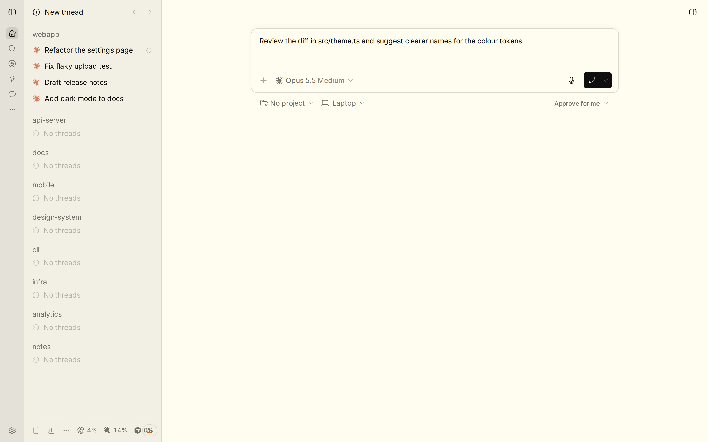
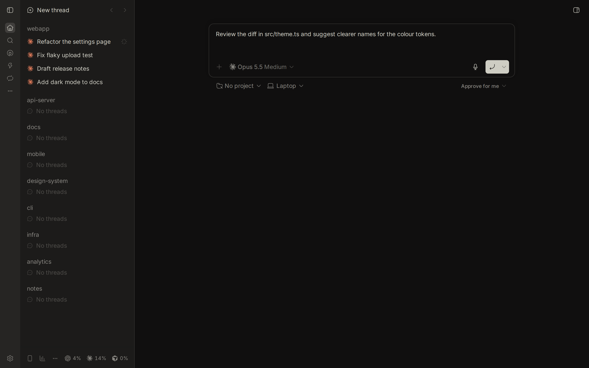

# Flexoki for BB

A [BB](https://getbb.app) theme plugin that ports [Flexoki](https://stephango.com/flexoki), an inky color scheme for prose and code by Steph Ango ([@kepano](https://github.com/kepano)). Source palette: [github.com/kepano/flexoki](https://github.com/kepano/flexoki).




## What it includes

- Light and dark UI palettes mapped from the Flexoki base and accent scales (600 accents in light mode, 400 in dark mode).
- The official Flexoki syntax themes from the Visual Studio Code port, copied unchanged, for diffs and file previews.
- The 16 Flexoki ANSI terminal colours.
- The system font stack from stephango.com/flexoki at Regular weight, with a compact text scale for chat, the composer and the sidebar; touch phones get slightly larger text.

## Install

From the BB plugin store, search for Flexoki. Or from a terminal:

```sh
bb plugin install git:https://github.com/ponomr/bb-plugin-flexoki.git@^0.1.0
```

Then open Settings → Appearance and choose Flexoki under Palette. Light, Dark and System appearance all work.

Requires BB 0.47.1 or later, below 1.0.

## Development

```sh
npm install
npm run typecheck
npm run build
bb plugin install "$PWD"
```

The theme lives in `themes/flexoki.css`; code themes are `themes/flexoki-dark.json` and `themes/flexoki-light.json`.

## Credits and licence

Flexoki is © 2023 Steph Ango, MIT licensed. This port is an independent adaptation and not an official Flexoki release. BB-specific mapping and packaging © 2026 Alex Ponomar, MIT. See [LICENSE](LICENSE) and [THIRD_PARTY_NOTICES.md](THIRD_PARTY_NOTICES.md).
